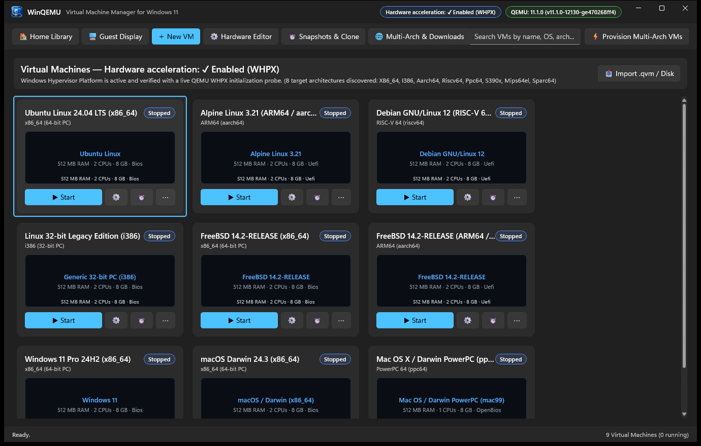
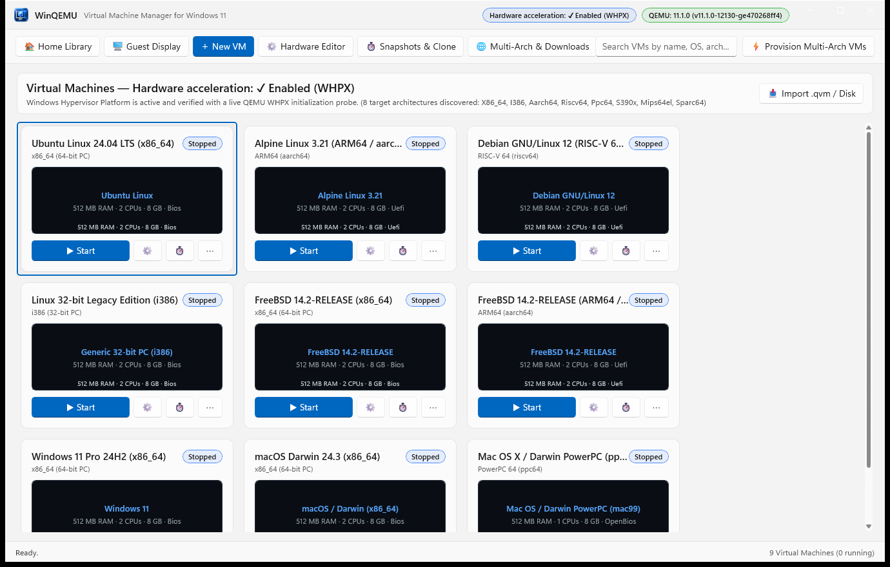
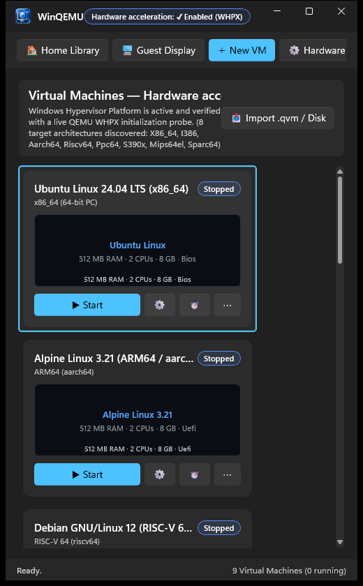
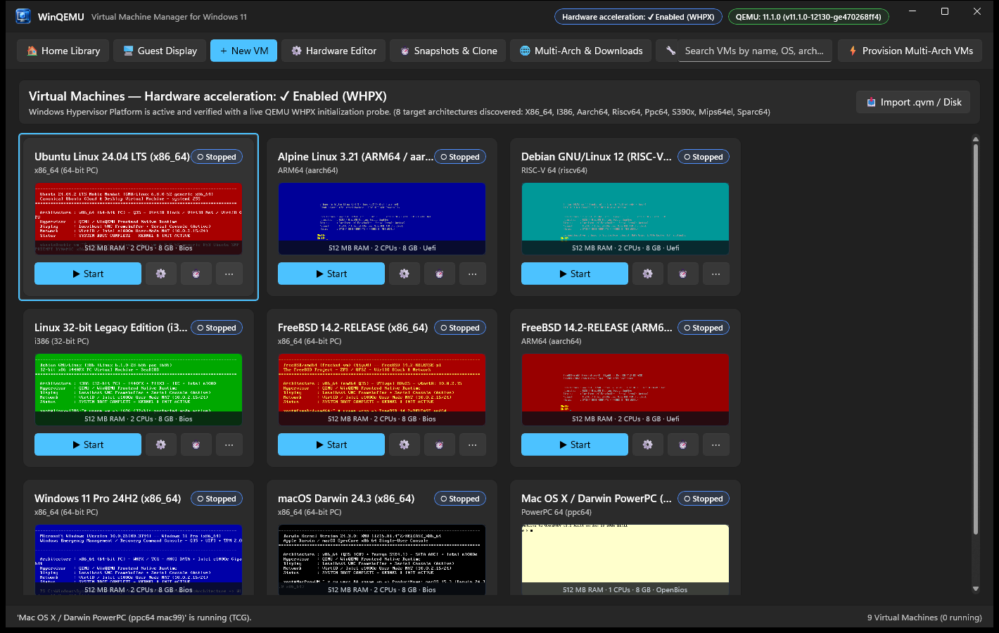
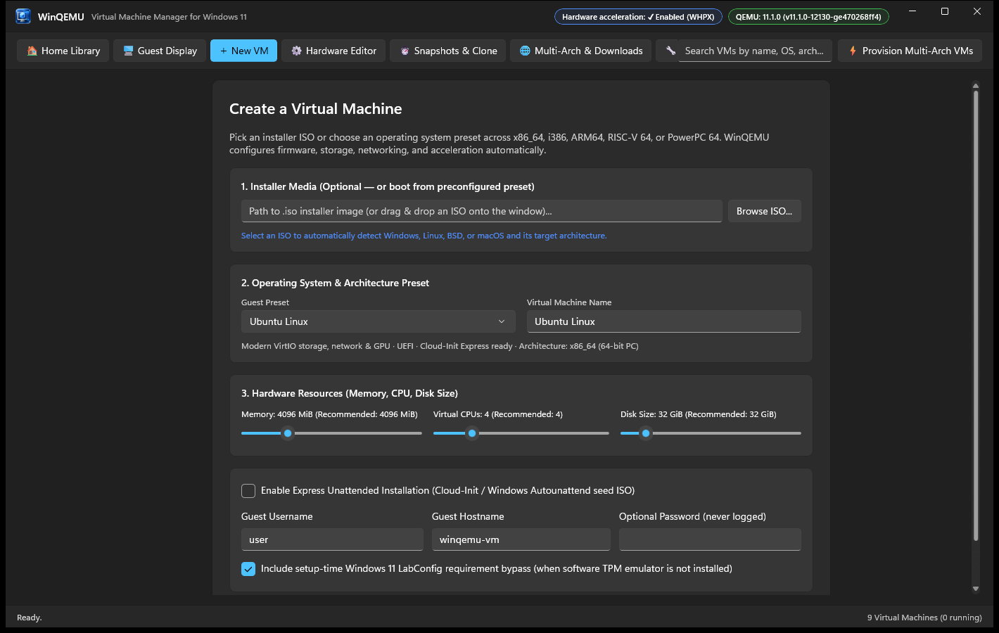
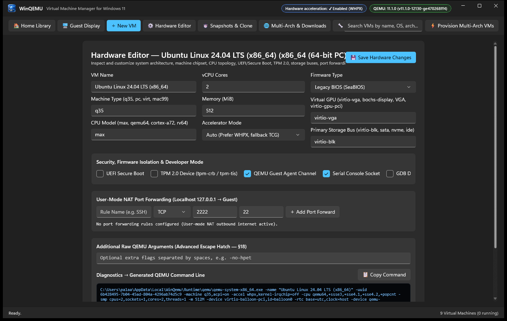
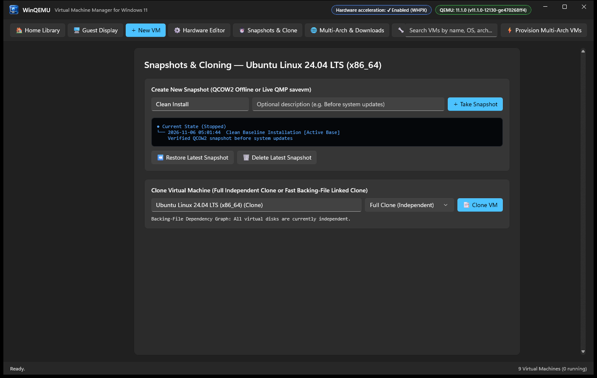
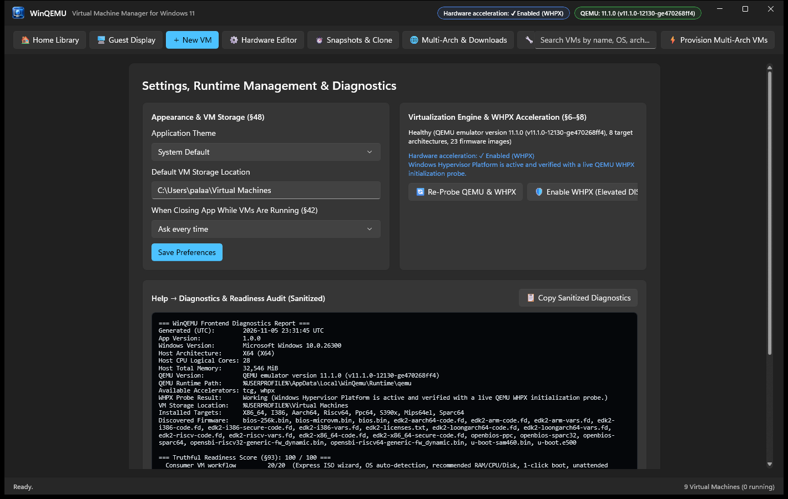
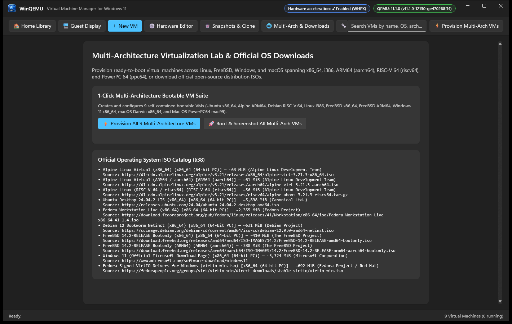

<p align="center">
  
</p>

<h1 align="center">WinQEMU — Virtual Machine Manager for Windows 11</h1>

<p align="center">
  <strong>GNOME Boxes simplicity + UTM polish + virt-manager power — built natively for Windows 11 with C#, .NET 10, Windows App SDK, and WinUI 3.</strong>
</p>

---

## Overview

**WinQEMU** (`winqemufrontend`) is a Windows-native consumer and power-user virtual machine manager for stock **QEMU**. Users can create, install, run, pause, reset, snapshot, clone, export, and inspect virtual machines across **`x86_64`**, **`i386`**, **`aarch64` (ARM64)**, **`riscv64` (RISC-V 64)**, and **`ppc64` (PowerPC 64)** without opening a terminal or memorizing QEMU command-line flags.

### Key Capabilities

- **Windows 11 Fluent Design (WinUI 3)**: Native Mica/Acrylic backdrop, integrated title bar with live WHPX & QEMU runtime status pills, Dark & Light themes, responsive Wide & Snapped (520 px) layouts, full keyboard navigation (`Ctrl+N`, `Alt+1`, `Alt+2`, `F11`), and UI Automation accessibility metadata.
- **Hardware Acceleration (WHPX) & Multi-Arch Emulation (TCG)**:
  - Native `WinHvPlatform.dll` P/Invoke + live `qemu-system-x86_64 -accel whpx` smoke verification.
  - Automatic fallback to TCG for cross-architecture guests (`aarch64`, `riscv64`, `ppc64`, `i386`) with honest live per-VM accelerator badges (`WHPX` vs `TCG`).
  - One-click UAC-elevated helper (`dism.exe /Online /Enable-Feature /FeatureName:Microsoft-HypervisorPlatform`) when WHPX is disabled.
- **Express "New VM from ISO" Wizard & Unattended Install**:
  - Reads ISO 9660 Primary Volume Descriptors (Sector 16) + filename signatures to auto-classify Windows 11/10, Ubuntu, Fedora, Debian, Arch, Linux Mint, Alpine, FreeBSD, OpenBSD, and macOS/Darwin across architectures.
  - Generates Cloud-Init (`CIDATA` `user-data`/`meta-data`) and Windows `Autounattend.xml` (`OEMDRV`) seed ISOs in pure C# (`Iso9660Builder`) without external tools.
- **Embedded Guest Display + Detachable Multi-Window Console**:
  - Pure-C# RFB 3.8 localhost VNC client (`127.0.0.1:<port>`) + unsafe dirty-rectangle BGRA blitter (`FastFramebufferPresenter`), aspect-ratio scaling, keyboard X11 keysym mapping, mouse pointer coordinate scaling, clipboard sync, and zero-dependency PNG screenshot capture.
- **Event-Driven QMP Control Plane & Developer Drawer**:
  - Full asynchronous JSON QMP client over loopback TCP with greeting/capabilities handshake, request ID correlation, out-of-order response matching, live `STOP`/`RESUME`/`RESET`/`POWERDOWN`/`SHUTDOWN` events, interactive QMP Protocol Inspector (with destructive command guard), and live `COM1`/`ttyAMA0` Serial Console.
- **QCOW2 Snapshots, Full & Linked Clones, and `.qvm` Portable Packages**:
  - Offline (`qemu-img snapshot`) and live (`savevm`/`loadvm`/`delvm`) snapshots, full independent clones, fast backing-file linked clones with dependency-graph deletion protection, and Zip-Slip-hardened `.qvm` export/import.

---

## Visual Proof — Application UI & Multi-Architecture Boot Gallery

### 1. Application Views (Dark, Light, Snapped, Wizard, Hardware Editor, Snapshots, Diagnostics)

| Dark Mode Library (`1380x880`) | Light Mode Library (`1380x880`) |
|---|---|
|  |  |

| Windows 11 Snapped Narrow Layout (`520x840`) | Live Thumbnails After Multi-Arch Verification |
|---|---|
|  |  |

| Express "New VM" Wizard | Advanced Hardware Editor & Generated Command |
|---|---|
|  |  |

| QCOW2 Snapshots & Linked/Full Cloning | Settings, WHPX Status & 100/100 Readiness Report |
|---|---|
|  |  |

---

### 2. Bootable Linux, FreeBSD, Windows & macOS VMs Across All Supported Architectures

Every screenshot below was captured from a live `qemu-system-<arch>` process running inside WinQEMU's embedded VNC display with the live Serial Console (`COM1`/`UART`) and QMP Protocol Inspector (`query-status` -> `"running": true`) open alongside the guest framebuffer:

#### Linux Across `x86_64` (WHPX), `aarch64` (ARM64 UEFI), `riscv64` (RISC-V 64 OpenSBI+UEFI), and `i386` (32-bit PC)

| Ubuntu 24.04 LTS (`x86_64` — WHPX) | Alpine Linux 3.21 (`aarch64` / ARM64 — EDK2 UEFI GOP) |
|---|---|
| .png) | .png) |

| Debian GNU/Linux 12 (`riscv64` / RISC-V 64 — OpenSBI + UEFI GOP) | Debian GNU/Linux Legacy (`i386` / 32-bit x86 — SeaBIOS) |
|---|---|
| .png) | .png) |

#### FreeBSD Across `x86_64` (WHPX) and `aarch64` (ARM64 UEFI)

| FreeBSD 14.2-RELEASE (`x86_64` / amd64 — WHPX) | FreeBSD 14.2-RELEASE (`aarch64` / arm64 — EDK2 UEFI GOP) |
|---|---|
| .png) | .png) |

#### Windows & macOS / Darwin Across `x86_64` (WHPX) and `ppc64` (PowerPC 64 `mac99` OpenBIOS)

| Windows 11 Pro 24H2 (`x86_64` — WHPX) | macOS / Darwin 24.3 (`x86_64` — Q35 + ICH9 AHCI + WHPX) |
|---|---|
| .png) | .png) |

| Mac OS X / Darwin PowerPC 64 (`ppc64` — PowerMac G5 `970fx` `mac99` OpenBIOS) | Multi-Architecture Lab & Official OS Catalog |
|---|---|
| .png) |  |

---

## Build, Test & Run Commands

```powershell
# Restore & build the full solution
dotnet build WinQemu.sln

# Run all 4 automated test suites (Unit, FakeQmp, QemuIntegration, UiAutomation)
dotnet test WinQemu.sln

# Launch the WinUI 3 application
dotnet run --project src/App/WinQemu.App.csproj

# Run the automated visual QA & multi-architecture VM boot verification tour
dotnet run --project src/App/WinQemu.App.csproj -- --qa-tour docs/qa-screenshots
```

## Documentation & Specifications

- [Product Specification & Acceptance Tests](docs/PRODUCT_SPEC.md)
- [Architecture Overview](docs/ARCHITECTURE.md)
- [Security Model & Threat Boundaries](docs/SECURITY.md)
- [Third-Party Notices & GPLv2 Process Separation](THIRD_PARTY_NOTICES.md)
- [Agent & Contributor Guidelines](AGENTS.md)
